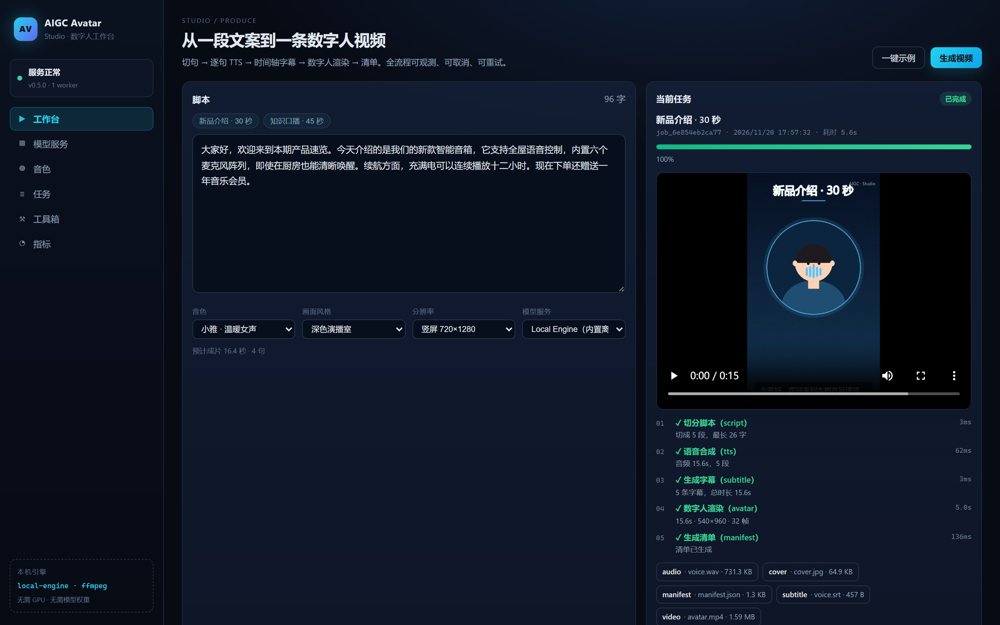
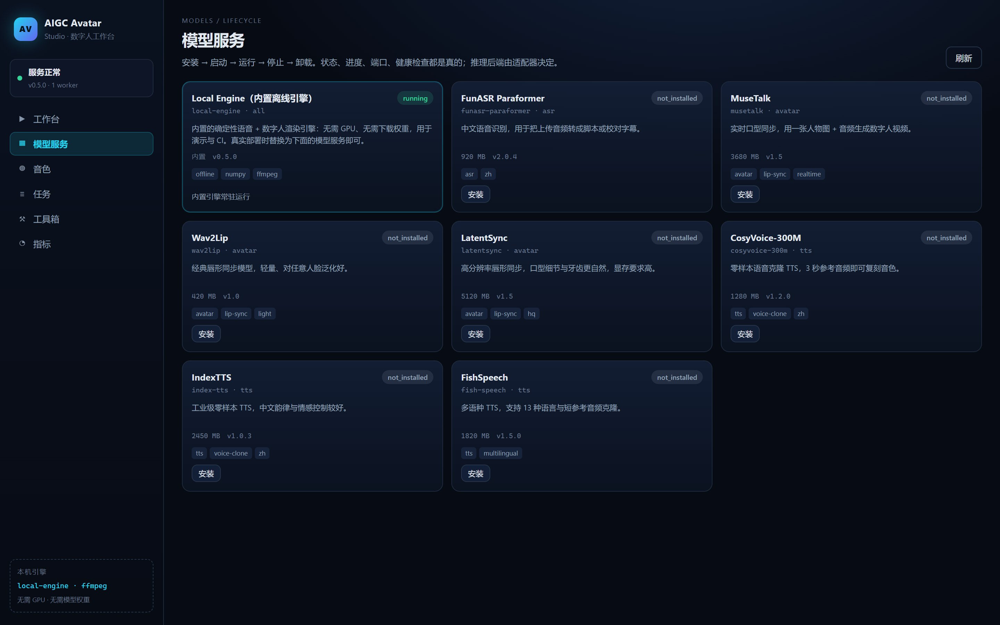
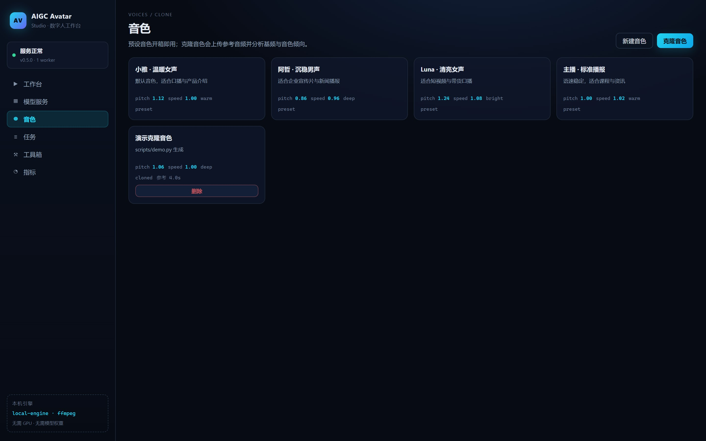

# AIGC Avatar Studio · AI 数字人内容生产平台

> 一段文案 → 一条带语音、字幕、数字人画面的视频。
> 服务端可运行：模型服务生命周期 + 媒体管线 + 任务队列 + FFmpeg 工具箱。

[](https://www.python.org/)
[](https://fastapi.tiangolo.com/)
[](https://ffmpeg.org/)
[](https://github.com/Zzhaocc/aigc-avatar-studio/actions/workflows/ci.yml)
[]()
[](LICENSE)

**仓库**：<https://github.com/Zzhaocc/aigc-avatar-studio>

---

## 这是什么

AIGC Avatar Studio 是服务端的数字人内容生产平台：一段文案进来，一条带语音、字幕、数字人画面的 MP4 出去。

```text
文案 → 切句 → 逐句 TTS → 拼接 → 时间轴字幕 → 逐帧渲染 → H.264/AAC 封装
                                                          ↓
                                       MP4 + WAV + SRT + 封面 + 清单
```

同时它把**模型服务**当成一等公民来管：8 个模型服务各自有安装目录、下载进度、端口与健康检查，
状态机覆盖「未安装 → 下载 → 已装 → 启动 → 运行 → 停止 → 卸载 → 失败」。
推理后端由适配器决定：内置离线引擎可直接使用，接真实模型只需把 `AIGC_<KEY>_URL` 指过去。

**不需要 GPU、不需要模型权重、不需要 API key**：内置引擎用 numpy 合成语音、Pillow + ffmpeg 渲染画面，
产出真实可播放的 WAV / MP4 / SRT。生产走服务端队列，有步骤级进度、取消、重试与恢复。

---

## 30 秒跑起来

唯一的外部依赖是 **ffmpeg**（`ffmpeg -version` 能跑即可）。

### Docker（推荐，镜像已含 ffmpeg 与中文字体）

```bash
git clone https://github.com/Zzhaocc/aigc-avatar-studio.git
cd aigc-avatar-studio
docker compose up -d --build
```

打开 <http://127.0.0.1:8000>，点「一键示例」，等 3–6 秒就能看到成片。

### 本地

```bash
git clone https://github.com/Zzhaocc/aigc-avatar-studio.git
cd aigc-avatar-studio
pip install -r requirements.txt
python -m uvicorn app.main:app --port 8000
```

Windows 也可以直接双击 `start.bat`，或运行 `.\scripts\run.ps1 -Port 8000`。

### 不启服务也能验证

```bash
python scripts/demo.py      # 跑一条完整生产链路，打印每步耗时与产物路径
```

---

## 控制台



工作台四块：脚本输入 → 音色/风格/分辨率 → 当前任务（进度、步骤、视频播放）→ 最近任务。

| 模型服务 | 音色 |
|---|---|
|  |  |

更多截图见 [`docs/screenshots/`](docs/screenshots/)：任务列表、指标、工具箱。

---

## 它能做什么

### 1. 模型服务生命周期

8 个模型服务（CosyVoice-300M / IndexTTS / FishSpeech / FunASR / MuseTalk / Wav2Lip / LatentSync / 内置引擎），
每个都有真实的安装目录、进度、端口与健康检查：

```text
not_installed →(install)→ downloading 0%…100% → installed
installed →(start)→ starting → running →(stop)→ stopped
任意可逆状态 →(uninstall)→ not_installed
安装失败 →(error)→ 可重新安装
```

安装会真的在 `data/models/<key>/` 下落目录与清单；启动会分配端口、写 `runtime.json`；
健康检查按端口探测。**推理后端由适配器决定**：内置引擎直接可用，其它模型需要把
`AIGC_<KEY>_URL` 指向真实服务（`app/providers/adapters.py` 里有 HTTP 适配器模板）。

### 2. 媒体管线

```text
脚本 → 切句（≤28 字）→ 逐句 TTS → 拼接 + 句间静音 → 时间轴字幕 → 数字人视频 → 缩略图 + 清单
```

- **TTS**：numpy 逐字合成（基频 + 谐波 + 包络 + 确定性抖动），输出 24kHz 单声道 WAV；
- **字幕**：按每句真实时长生成 SRT，时间轴与音频一致；
- **视频**：Pillow 逐帧渲染（渐变背景 + 数字人头像 + 音频包络驱动的口型条 + 字幕），
  ffmpeg 编码 H.264 + AAC，2 fps 保证速度，成片可直接播放；
- **音色**：pitch / speed / timbre 三个参数直接作用在合成器上，克隆音色会分析参考音频的基频。

### 3. 任务队列

单 worker 顺序执行（对应单卡 GPU 的真实约束），任务与步骤分离：

- 5 个步骤各自报进度与耗时：script / tts / subtitle / avatar / manifest
- 取消是协作式的（每个句子前检查），1 秒内生效
- 失败可一键重试；进程重启会把中断任务标为 failed，不会永远 running

### 4. 工具箱（FFmpeg）

对任意产物做 probe / 提取音轨 / 截封面 / 调倍速，结果作为新产物落库。

### 5. 可观测

- 每个任务有步骤耗时、产物大小、时长；`/api/metrics` 给出成功率、平均耗时、产物体积、模型磁盘占用；
- 结构化日志（`text` / `json`），每条带 `request_id`，与响应头 `X-Request-ID` 对齐；
- 两个探针：`/api/health`（存活）、`/api/ready`（数据库 / ffmpeg / 数据目录）。

---

## 架构

```text
              ┌──────────────── 接入层 ────────────────┐
              │   REST /api  ·  Web 控制台  ·  Swagger  │
              │   CORS → X-Request-ID → 安全响应头      │
              └───────────────────┬────────────────────┘
                                  │
        ┌─────────────────────────▼──────────────────────────┐
        │                    任务队列 JobRunner               │
        │  单 worker · 步骤进度 · 协作式取消 · 重试 · 崩溃恢复 │
        └───────────┬──────────────────────────┬────────────┘
                    │                          │
        ┌───────────▼──────────┐    ┌──────────▼───────────┐
        │   生产管线 produce    │    │  模型服务 Manager     │
        │ 切句→TTS→字幕→渲染    │    │ 安装/启动/停止/健康   │
        └───────────┬──────────┘    └──────────┬───────────┘
                    │                          │
        ┌───────────▼──────────────────────────▼───────────┐
        │              推理引擎适配器 Engine                │
        │   LocalEngine（numpy + Pillow + ffmpeg）          │
        │   RemoteHTTPEngine（CosyVoice / MuseTalk 模板）   │
        └───────────────────────────────────────────────────┘
```

**边界**：管线只依赖 `TTSEngine` / `AvatarEngine` 两个 Protocol，
换真实模型只改适配器，任务队列、API、前端都不用动。

分层细节、状态机、失败模式与取舍见 [架构与设计决策](docs/ARCHITECTURE.md)。

---

## 配置

全部通过环境变量注入，完整清单见 [`.env.example`](.env.example) 与 [运维手册](docs/OPERATIONS.md)。

| 变量 | 默认 | 说明 |
|---|---|---|
| `AIGC_DATA_DIR` | `./data` | 数据根目录，派生 `media/` `models/` `uploads/` |
| `DATABASE_URL` | `sqlite:///./data/studio.db` | 换 PostgreSQL 只改这一行 |
| `FFMPEG_BIN` / `FFPROBE_BIN` | `ffmpeg` / `ffprobe` | 可执行文件路径 |
| `AIGC_FFMPEG_TIMEOUT` | `300` | 单条 ffmpeg 命令超时（秒） |
| `AIGC_SAMPLE_RATE` | `24000` | 输出采样率，贯穿 TTS / 拼接 / 抽音轨 |
| `AIGC_WIDTH` / `AIGC_HEIGHT` / `AIGC_FPS` | `720` / `1280` / `2` | 默认分辨率与帧率 |
| `AIGC_MAX_WORKERS` | `1` | 队列并发 |
| `AIGC_REMOTE_TIMEOUT` | `120` | 远程推理请求超时（秒） |
| `CORS_ORIGINS` | `*` | 生产填具体域名 |
| `LOG_LEVEL` / `LOG_FORMAT` | `INFO` / `text` | `json` 用于日志采集 |
| `DOCS_ENABLED` | `true` | 生产建议关闭 `/docs` |

---

## API 示例

完整接口见 [`docs/API.md`](docs/API.md)，`examples/` 下是可直接执行的请求。

```bash
# 探针
curl http://127.0.0.1:8000/api/health
curl http://127.0.0.1:8000/api/ready

# 一键示例
curl -X POST http://127.0.0.1:8000/api/demo/run

# 自定义生产
curl -X POST http://127.0.0.1:8000/api/produce \
  -H "Content-Type: application/json" \
  -d '{"script":"大家好，这是一条测试。","voice_id":"voi_xxx","style":"news"}'

# 查任务（步骤 + 产物）
curl http://127.0.0.1:8000/api/jobs/{job_id}

# 下载成片
curl -OJ http://127.0.0.1:8000/api/assets/{asset_id}

# 安装并启动一个模型服务
curl -X POST http://127.0.0.1:8000/api/models/{model_id}/install
curl -X POST http://127.0.0.1:8000/api/models/{model_id}/start
```

所有错误响应统一为 `{"detail": ..., "request_id": ...}`，排查时按 `request_id` 检索日志。

---

## 部署与运维

```bash
make install-dev     # 安装开发依赖（含测试与 ruff）
make test            # 测试 + 覆盖率（需要 ffmpeg）
make lint            # ruff 静态检查
make smoke           # 对已启动的服务做端到端冒烟
make docker-build    # 构建镜像（内含 ffmpeg 与中文字体）
```

- **探针**：`/api/health`（存活，不查库）、`/api/ready`（就绪：数据库 / ffmpeg / ffprobe / 数据目录可写）；
- **日志**：`LOG_FORMAT=json` 接采集平台，按 `request_id` 关联一次请求；
- **备份**：`sqlite3 data/studio.db ".backup ..."` + 打包 `data/media`、`data/uploads`、`data/models`；
- **扩容**：队列是进程内线程池，多机需要换外部队列 + 对象存储；内置接口不带鉴权，对外必须置于网关之后。

完整部署形态、故障排查表与上线检查清单见 [运维手册](docs/OPERATIONS.md)，
安全边界与漏洞报告流程见 [SECURITY.md](SECURITY.md)。

---

## 测试

```bash
python -m pytest -q     # 38 passed
```

| 分组 | 数量 | 覆盖 |
|---|---|---|
| 媒体 | 14 | WAV 合成与确定性、SRT 时间轴、MP4 编码、ffprobe 探测、工具箱四件套 |
| 管线 | 5 | 切句、五步端到端、取消、重试、清单完整性 |
| API | 8 | 契约校验（404/409/422）、模型生命周期、产物下载、工具箱、指标 |
| 平台 | 11 | 探针、request_id、安全响应头、错误契约、产物路径校验、配置解析与两条回归 |

CI 在 push / PR 时跑 ruff + pytest（3.11 / 3.13，含真实 ffmpeg 编码与中文字体）+ HTTP 冒烟，
见 [`.github/workflows/ci.yml`](.github/workflows/ci.yml)。

---

## 能力边界

| 项目 | 现状 |
|---|---|
| 模型权重 | 只管理服务元数据与生命周期，不下载权重；推理需外部服务或内置引擎 |
| 数字人画面 | 内置渲染器画的是抽象形象（圆盘头像 + 口型条），不是真人；接真实模型后画面来自模型 |
| FFmpeg 工具 | 4 个高频工具（探测 / 抽音轨 / 截封面 / 倍速），都是真实调用 |
| 形态 | 服务端 + Web 控制台，不做桌面端打包 |
| 直播 | 不做推流 |

接真实模型后，队列、管线、字幕、产物链路完全一致，只有推理后端和画面来源变化。

---

## 目录

```text
aigc-avatar-studio/
├── app/
│   ├── main.py                  # 应用装配、中间件、启动收敛与恢复
│   ├── config.py                # 环境变量配置（单一数据根目录）
│   ├── logging.py               # 结构化日志 + request_id 注入
│   ├── middleware.py            # 请求关联 ID、访问日志、安全响应头
│   ├── errors.py                # 统一错误响应
│   ├── db.py / models.py        # SQLAlchemy 模型（ModelService/Voice/Job/JobStep/Asset）
│   ├── api/                     # REST 路由 + 请求模型
│   ├── providers/
│   │   ├── catalog.py           # 8 个模型服务 + 预设音色
│   │   ├── manager.py           # 安装/启动/停止/卸载/健康状态机
│   │   ├── adapters.py          # LocalEngine + RemoteHTTPEngine 模板
│   │   └── base.py              # TTS/Avatar/ASR Protocol
│   ├── pipeline/
│   │   ├── script.py            # 切句与时长估算
│   │   ├── produce.py           # 五步生产管线
│   │   └── jobs.py              # 队列、进度、取消、重试
│   └── media/                   # TTS(WAV) / 字幕(SRT) / 数字人渲染(MP4)
├── web/                         # 单页控制台
├── tests/                       # 媒体 / 管线 / API / 平台（38 个）
├── examples/                    # curl / .http 示例
├── scripts/                     # demo / 冒烟 / 截图
├── docs/                        # 架构、API、运维手册、截图
├── Dockerfile                   # 多阶段构建，内置 ffmpeg 与中文字体、非 root
├── docker-compose.yml
└── Makefile                     # install / run / test / lint / smoke / docker-*
```

---

## Roadmap

| 版本 | 内容 |
|---|---|
| v0.6（当前） | 生产化加固：结构化日志与 request_id、探针、统一错误契约、容器化、运维与安全文档 |
| v0.7 | 真实 TTS 适配器（CosyVoice / IndexTTS），保留 `synthesize` 契约 |
| v0.8 | 对象存储与产物签名 URL；任务中间帧目录自动清理 |
| v0.9 | 外部队列 + 多副本；长脚本分片与断点续跑 |
| v1.0 | 数字人形象库与多模板；字幕样式可配置 |

变更记录见 [CHANGELOG.md](CHANGELOG.md)。

---

## 文档

- [架构与设计决策](docs/ARCHITECTURE.md) —— 分层、模型状态机、生产管线、可观测、安全边界、取舍
- [API 参考](docs/API.md) —— 全部端点、探针、错误契约与示例
- [运维手册](docs/OPERATIONS.md) —— 部署形态、探针、日志排障、备份、扩容、上线清单
- [安全策略](SECURITY.md) —— 安全边界与漏洞报告流程
- [贡献指南](CONTRIBUTING.md) —— 本地开发、PR 前必过的检查、如何接真实模型

---

## 致谢与许可

- 致谢 [AIGCPanel](https://github.com/modstart-lib/aigcpanel)：产品形态来源；
- 项目名称沿用 AIGC 数字人领域的通用叫法，示例素材与音色均为程序生成，不含真实人物；
- MIT License，见 [LICENSE](LICENSE)。
